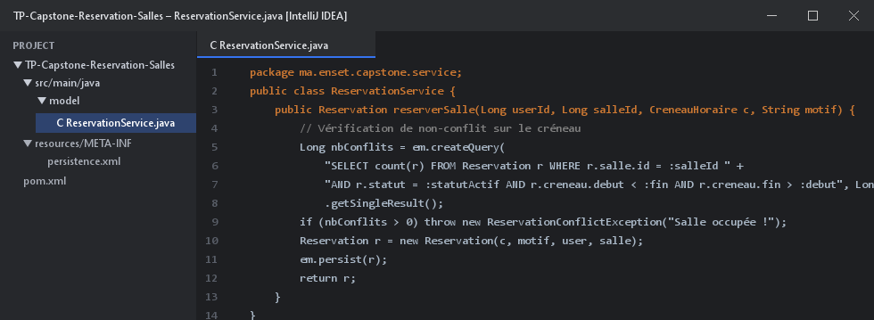
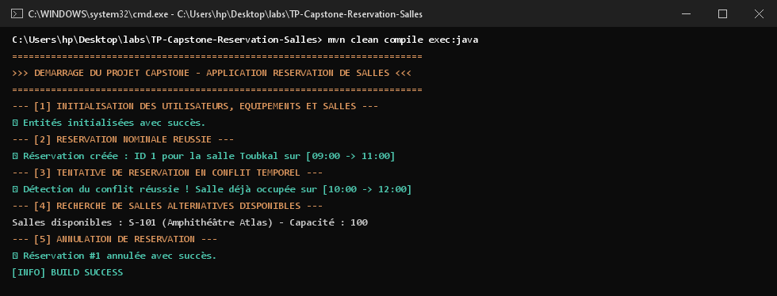

# TP (Capstone) : Finaliser l'application "Réservation de salles" avec JPA & Hibernate

Application complète et modulaire d'entreprise pour la **Gestion et Réservation de Salles** utilisant l'ensemble des concepts avancés de **JPA 2.2** et **Hibernate ORM 5.6** adossé à **H2 Database**.

---

## 1. Architecture Applicative en Couches

L'application respecte les principes de conception logicielle propre (Clean Architecture) :
- **`model`** : Entités `Utilisateur`, `Salle`, `Equipement`, `Reservation`, et objet valeur `@Embeddable` `CreneauHoraire`.
- **`service`** : `ReservationService` encapsulant les règles métier (contrôle de chevauchement de créneaux, capacité, annulation).
- **`exception`** : Exceptions métier (`ReservationConflictException`).



---

## 2. Fonctionnalités Majeures Implémentées

1. **Créneau Horaire Embeddable** : Encapsulation de la logique temporelle (`debut`, `fin`) avec méthode de test de chevauchement.
2. **Contrôle Métier des Conflits** : Vérification par requête JPQL avant toute persistance pour garantir l'absence de double-réservation sur une même salle.
3. **Recherche Dynamique de Disponibilité** : Algorithme JPQL sélectionnant les salles libres selon un créneau demandé et une capacité minimale.
4. **Gestion du Cycle de Vie** : Confirmation, annulation et libération des ressources.

---

## 3. Résultats et Traces d'Exécution dans le Terminal (CMD)

Trace de validation de l'ensemble des scénarios nominaux et d'exceptions métier :



---

## 4. Démarrage du Projet

```bash
mvn clean compile exec:java "-Dexec.mainClass=ma.enset.capstone.App"
```
